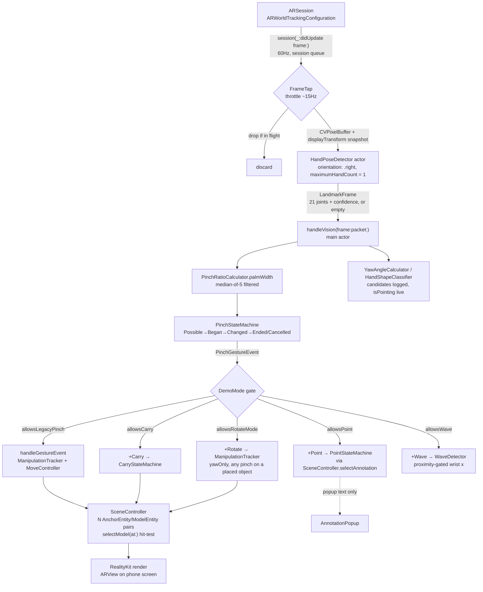

# ARCHITECTURE — Coral AR Placement Experiment

**Date:** 2026-08-12
**Status:** describes the code as it exists. The original six build phases (0–5) are complete and verified. Work since has been the "gesture build track" (Point / Carry / Rotate / Wave), built on the cube prototype. **Phase 6 — swapping the cube for a real `coral.usdz` — has not started.** There is no `coral.usdz` in the repo and `ModelProvider` still generates a cube. The content layer (dirt, pests, quiz, real annotation text) does not exist yet. **Live use is roaming handheld** (ADR-020); pipeline unchanged from the desk-stand de-risking build.
**Constraints:** see [`AGENTS.md`](AGENTS.md). **Rationale:** see [`DECISIONS.md`](DECISIONS.md). **Gesture semantics:** see [`GESTURES.md`](GESTURES.md). **Feasibility case, prior art, risk log:** see [`PROJECT.md`](PROJECT.md).

---

## 1. The shape of the thing

The pipeline is still one unidirectional flow, camera to pixels, with **one queue hop** (into and back out of Vision, via a Swift actor). What is no longer true is "exactly one stateful node." There are **seven**, each owning one concern: `PinchStateMachine` (pinch lifecycle), `ManipulationTracker` (scale-only/yaw-only mode-lock + dwell-commit, shared by Adjust A and Rotate), `MoveController` (absolute-from-grab position), `CarryStateMachine` (pick-up/put-down toggle), `PointStateMachine` (dwell-to-hover), `WaveDetector` (reversal/stationary-hold), `VerticalSlideScale` (Adjust B's standalone vertical-slide-to-scale accumulator — deliberately not part of `ManipulationTracker`, its log-ratio math doesn't transfer to a linear screen slide). None know about each other directly — `ARSessionCoordinator` and its five `+Point`/`+Carry`/`+Rotate`/`+Wave`/`+AdjustSlide` extensions are the only code that reads one machine's output and feeds another.

The 2D/3D seam from the original design still holds, just relocated: `Gesture/` imports no RealityKit. `PinchGestureEvent`, `AnnotationID`, and `EntityID` (a bare `ObjectIdentifier` typealias) are the only things that cross from Gesture into AR, and `SceneController` is the only place an `ObjectIdentifier(ModelEntity)` gets minted into an `EntityID`.

What decides which of the seven machines is even listening this frame is `DemoMode` — seven cases (`place`, `adjustSpread`, `adjustSlide`, `move`, `rotate`, `point`, `sim`), a **hard override** set from the HUD. Exactly one mode is live at a time; there is no timing-based auto-switching on the live path (ADR-019 deleted the one that existed — see §4). `adjustSpread`/`adjustSlide` are the "Adjust A"/"Adjust B" scale-only A/B test modes — yaw no longer lives in Adjust at all, it's exclusively `rotate`'s.



Text form:

```
ARSession
  -> frame tap (throttled ~15Hz, drops rather than queues)
    -> HandPoseDetector actor (Vision, orientation: .right, maximumHandCount = 1)
      -> LandmarkFrame (21 joints + confidence, or empty on a miss/error)
        -> median-of-5 filter on palmWidth pinchRatio
          -> PinchStateMachine (hysteresis + grace period) -> PinchGestureEvent
            -> DemoMode gate (hard override; not a race between modes)
              -> place/adjust/move -> ManipulationTracker (scale/yaw lock) + MoveController (grab-relative)
              -> sim (carry)       -> CarryStateMachine (toggle)
              -> rotate            -> ManipulationTracker (yawOnly, any pinch on a placed object)
              -> point             -> HandShapeClassifier.isPointing -> PointStateMachine (dwell)
              -> sim (wave)        -> WaveDetector (reversal or stationary-hold)
                -> SceneController (scale/yaw/position on the child ModelEntity; selectModel(at:) hit-test)
                  -> RealityKit render (ARView on phone screen)
```

---

## 2. Module breakdown

Each type has one responsibility. If a type needs two sentences to describe, it's two types — with one honest exception noted below.

### Capture and inference

| Type | File | Single responsibility |
|---|---|---|
| `FrameTap` | `Vision/FrameTap.swift` | Throttle + drop-if-busy gate. Snapshots `capturedImage`, `displayTransform`, and `imageResolution` into a `FramePacket` and releases the `ARFrame` immediately. |
| `HandPoseDetector` | `Vision/HandPoseDetector.swift` | A Swift **actor**, not a class on a manual queue. Runs `DetectHumanHandPoseRequest`, hardcodes `orientation: .right`, `maximumHandCount = 1`. Returns `nil` on a Vision error, or an empty `LandmarkFrame` (`joints: [:]`) when Vision ran but found no hand — that distinction matters downstream (§5). |
| `LandmarkFrame` | `Vision/LandmarkFrame.swift` | Immutable `Sendable` value type: 21 joints keyed by `JointName`, confidence, chirality, `inferenceHz`. Also owns `pinchPoint(confidenceGate:)` and `indexTipPoint(confidenceGate:)`, the two convenience accessors placement and point-and-dwell both use. |
| `LandmarkSpace` | `Vision/LandmarkSpace.swift` | Unchanged in shape: three named functions, Vision-normalized → image-normalized → viewport pixels via `displayTransform`. Still the only place this conversion happens. |

### Gesture — pure math

| Type | File | Single responsibility |
|---|---|---|
| `PinchRatioCalculator` | `Gesture/PinchRatioCalculator.swift` | Computes three candidate ratios (`wristMCP`, `bboxDiag`, `palmWidth`) plus the raw thumb-index distance. `palmWidth` is what ships (ADR-015, re-derived in ADR-017); the other two are logged for comparison, nothing else. |
| `YawAngleCalculator` | `Gesture/YawAngleCalculator.swift` | Three angle candidates (`thumbIndex`, `palmAxis`, `wristMiddle`), aspect-corrected for the 4:3 `ARFrame` buffer. ⚠️ **None of the three drives the live yaw mechanic** — see §4. All three are computed and CSV-logged every gesture event purely for A/B comparison. |
| `HandShapeClassifier` | `Gesture/HandShapeClassifier.swift` | `isOKSign` (dead in the live pipeline — the pause-override that called it was pulled; kept for a future calibrated hold-gate) and `isPointing` (live, gates Point mode). Both key off the same palm-width-normalized finger-extension ratio. |
| `GestureTuning` | `Gesture/GestureTuning.swift` | Every constant, one struct. Current shipping values include: `pinchThreshold` 1.98, `hysteresisBand` 1.0 (ADR-017); `scaleDeadzoneLog` 0.18, `yawDeadzoneRad` 0.35; `scaleSensitivity` 0.5 vs `scaleShrinkSensitivity` 1.75 (deliberately asymmetric — closing has less physical travel left than opening); `dwellDuration` 0.4s; `carryToggleMaxDuration` 0.7s; `waveHoldDuration` 2.0s. Every value carries its own provenance in a doc-comment (measured / ad-hoc / plan placeholder) — read the file, don't assume. |

### Gesture — state and control

| Type | File | Single responsibility |
|---|---|---|
| `PinchStateMachine` | `Gesture/PinchStateMachine.swift` | Pinch lifecycle only: Possible→Began→Changed→Ended/Cancelled, ~100ms hysteresis + 200ms grace. Emits `PinchGestureEvent`. Not fully self-contained: `exitThresholdOverride` is mutated from `ARSessionCoordinator` while scale is locked (§4), so opening the fingers wide — the scale signal itself — doesn't trip an early pinch-end. |
| `ManipulationTracker` | `Gesture/ManipulationTracker.swift` | Mode-lock (scale vs. yaw) + baseline capture + settling-window arming + dwell-to-commit, for one held pinch. Starts only after `PinchStateMachine` says `.began`; a completely separate struct with its own lifecycle. |
| `MoveController` | `Gesture/MoveController.swift` | Absolute-from-grab positioning, EMA-smoothed. Also declares `GrabTrigger` and `moveOrAdjustTrigger` — a pure, unit-tested timing decision (`MoveTriggerTests`) that shipped but is **not called anywhere on the live path**; ADR-019 replaced it with the hard `DemoMode` override. |
| `CarryStateMachine` | `Gesture/CarryStateMachine.swift` | Pinch-toggle latch: a short pinch (< `carryToggleMaxDuration`) picks up or puts down; a longer one is a grab-and-drag and is ignored. Also declares `EntityID` (the `ObjectIdentifier` typealias), `CarryEvent`, and `routeCarryPinch` — the pure decision of whether a fresh pinch is a new carry or a re-grab-rotate. |
| `PointStateMachine` | `Gesture/PointStateMachine.swift` | Dwell-to-hover: holds a target for `pointDwellDuration` before firing `.hoverBegan`, same grace-period pattern as `PinchStateMachine`. Also declares `AnnotationID` and `PointEvent`. |
| `WaveDetector` | `Gesture/WaveDetector.swift` | Reversal-count-and-amplitude, OR a stationary-hold fallback — either accumulates toward `waveHoldDuration`; a gap decays progress, it does not hard-reset it. |

### AR and scene

| Type | File | Single responsibility |
|---|---|---|
| `CoralARApp` | `CoralARApp.swift` | SwiftUI entry point. Composes the `ARView` container, `LandmarkDotsOverlay`, `HandDebugOverlay`, `ARStatusHUD`, and an inline `AnnotationPopup` (placeholder text popup — enough to exercise point-and-dwell, not a real annotation UI). |
| `ARSessionCoordinator` | `AR/ARSessionCoordinator.swift` | Owns `ARView`/`ARSession`, is the `ARSessionDelegate`, and is the dispatcher: `handleVision` runs on every processed frame in a fixed order — *ratio → overlay → pinch → carry/rotate/adjustSlide → point → wave* (named explicitly in the source) — then runs the legacy Place/Adjust A/Move handler gated by `demoMode.allowsLegacyPinch`. At ~800 lines this is the largest file in the codebase and does not fit the one-sentence rule; the five extensions below exist specifically so it isn't one 1500-line file. |
| `ARSessionCoordinator+Point.swift` | same dir | Point-and-dwell dispatch: index fingertip + `HandShapeClassifier.isPointing` → `SceneController.selectAnnotation(at:)` → `PointStateMachine`. Live only under `demoMode.allowsPoint` (`.point`); fed a nil target otherwise so an in-flight dwell can still time out. |
| `ARSessionCoordinator+Carry.swift` | same dir | Pinch-toggle pick-up/put-down dispatch: routes each `PinchGestureEvent` through `routeCarryPinch` to `CarryStateMachine`. Live under `demoMode.allowsCarry` (`.sim` only — the standalone `.carry` mode was removed 2026-08-12; `routeCarryPinch`'s re-grab-rotate branch is unreachable now that `allowsRotate` is always `false`, left in place untouched). |
| `ARSessionCoordinator+Rotate.swift` | same dir | Begins/updates/ends a rotate using the same `ManipulationTracker` Adjust A uses, `yawOnly: true`. Two callers: Adjust A's shared `beginManipulation`/`applyManipulation`/`finishManipulation` primitives, and its own top-level `.rotate` mode routing (`handleRotateModeRouting`) — any pinch on a placed object rotates it, gated on `demoMode.allowsRotateMode` (`.rotate` only). |
| `ARSessionCoordinator+AdjustSlide.swift` | same dir | Adjust B (vertical-slide scale) dispatch: begins/updates/ends a standalone `VerticalSlideScale` (never touches `ManipulationTracker` — its log-ratio math doesn't transfer to a linear screen slide). Gated on `demoMode.allowsAdjustSlide` (`.adjustSlide` only); first pinch on an empty scene places, same as legacy Place/Adjust A/Move. |
| `ARSessionCoordinator+Wave.swift` | same dir | Wrist-position wave/stationary-hold dispatch: gates a live wrist x to `WaveDetector` only inside a screen-radius (`waveProximityRadiusPt`, 220pt — a content-layer placeholder, not a `GestureTuning` constant) of a marker on the active cube's top face. Live under `demoMode.allowsWave` (`.sim`). |
| `PlacementService` | `AR/PlacementService.swift` | Unchanged: `.existingPlaneGeometry` → `.existingPlaneInfinite` → `.estimatedPlane` raycast fallback chain. |
| `SceneController` | `AR/SceneController.swift` | **Owns every placed entity, not one.** `place()` appends a new `AnchorEntity`/`ModelEntity` pair — multi-object since ADR-019 — with a position-only, identity-rotation anchor (gravity-aligned regardless of raycast tier). `selectModel(at:)` / `selectAnnotation(at:)` try `ARView.entity(at:)` first (parent-walk so a hit on child geometry, e.g. an annotation marker, resolves to the placed model), then nearest projected candidate within `screenGrabRadiusPt` (220pt). A miss outside that radius leaves `activeModel` untouched. Also owns per-model yaw (decoded from the entity's own quaternion each time, not a stored field — a stored field leaked rotation between objects), scale with vertical compensation (so the base doesn't sink/float as it grows/shrinks), highlight-by-material-swap, and annotation registration. |
| `ModelProvider` | `AR/ModelProvider.swift` | Still returns a generated 5cm cube. Phase 6 has not started. |
| `PlaneScanCoordinator` | `AR/PlaneScanCoordinator.swift` | Unchanged. |

### Debug and instrumentation

| Type | File | Single responsibility |
|---|---|---|
| `ARStatusHUD` | `Debug/ARStatusHUD.swift` | The on-screen HUD: plane/gesture/mode status card, the seven-way `DemoMode` picker, plane/landmark-dot toggles, torch control, and the Open/Pinched buttons used to label ground truth into the CSV. |
| `HandDebugOverlay` | `Debug/HandDebugOverlay.swift` | Two views, one file. `HandDebugOverlay` draws the pinch-point/raycast-hit crosshair pair (misalignment = visible gap). `LandmarkDotsOverlay` — also in this file — draws the 21 confidence-colored joint dots. **CoralAR has no `LandmarkOverlayView.swift` or `LiveReadoutView.swift`; those names exist only under `HandProbe/`.** |
| `MetricsLogger` | `Debug/MetricsLogger.swift` | Appends CSV rows to `Documents/`, one file per session (`phase5_manip_*.csv` — the filename is a holdover from when this schema was introduced, not a live phase gate). Logs plane, placement, gesture, manipulation, and calibration events. |

---

## 3. Targets, sharing, and the directory tree

Three targets: `HandProbe` (app), `HandProbeTests` (unit tests, depends on `HandProbe`), `CoralAR` (app). There is no migration left to describe — that already happened. What's live now is a **source-sharing arrangement** declared in `project.yml`: `HandProbe`'s target lists ten files that physically live under `CoralAR/` — `GestureTuning`, `PinchStateMachine`, `HandShapeClassifier`, `PinchRatioCalculator`, `LandmarkFrame`, `ManipulationTracker`, `MoveController`, `PointStateMachine`, `CarryStateMachine`, `WaveDetector` — directly in its own `sources:` list, so both targets compile the *same file*, not parallel forks. `HandProbeTests` exercises these through `@testable import HandProbe`, which is why the tests double as coverage for `CoralAR`'s gesture logic despite never importing `CoralAR`.

What's still genuinely separate: `HandProbe`'s own camera stack (`CameraFeed` — plain `AVCaptureSession`, not ARKit, by design per ADR-009), its own `HandPoseDetector` actor (a different, older implementation from `CoralAR/Vision/HandPoseDetector.swift` — same Vision API, different plumbing, not shared), its own `MetricsLogger` (Phase 0–1 CSV schema, distinct columns from `CoralAR`'s), and its debug UI (`LandmarkOverlayView`, `LiveReadoutView`). `HandProbe` is what produced the Phase 0–2 calibration CSVs; it still builds and stays in the tree for re-measurement if the rig ever changes, but it is not part of the shipping app.

```
Ch5B/
├── docs/
│   ├── AGENTS.md
│   ├── ARCHITECTURE.md
│   ├── DECISIONS.md
│   ├── GESTURES.md
│   └── PROJECT.md
│
├── HandProbe/                       ← Phase 0–2 probe. Still builds. Not the shipping app.
│   ├── HandProbeApp.swift
│   ├── CameraFeed.swift             ← plain AVCaptureSession, not ARKit (ADR-009)
│   ├── CameraPreviewView.swift
│   ├── ProbeController.swift
│   ├── HandPoseDetector.swift       ← HandProbe's own actor — not shared with CoralAR
│   ├── LandmarkOverlayView.swift
│   ├── LiveReadoutView.swift
│   └── MetricsLogger.swift          ← Phase 0–1 CSV schema
│
├── HandProbeTests/                  ← Unit tests. Live and current — covers the state machines.
│   ├── PinchStateMachineTests.swift
│   ├── CarryStateMachineTests.swift
│   ├── HandShapeClassifierTests.swift
│   ├── ManipulationTrackerTests.swift
│   ├── ManipulationTrackerSettlingTests.swift
│   ├── ManipulationTrackerDwellTests.swift
│   ├── MoveTriggerTests.swift
│   ├── PointStateMachineTests.swift
│   └── WaveDetectorTests.swift
│
├── CoralAR/                         ← THE REAL APP.
│   ├── CoralARApp.swift
│   ├── AR/
│   │   ├── ARSessionCoordinator.swift
│   │   ├── ARSessionCoordinator+Point.swift
│   │   ├── ARSessionCoordinator+Carry.swift
│   │   ├── ARSessionCoordinator+Rotate.swift
│   │   ├── ARSessionCoordinator+Wave.swift
│   │   ├── PlacementService.swift
│   │   ├── SceneController.swift
│   │   ├── ModelProvider.swift
│   │   └── PlaneScanCoordinator.swift
│   ├── Vision/
│   │   ├── FrameTap.swift
│   │   ├── HandPoseDetector.swift
│   │   ├── LandmarkFrame.swift
│   │   └── LandmarkSpace.swift
│   ├── Gesture/
│   │   ├── GestureTuning.swift
│   │   ├── PinchRatioCalculator.swift
│   │   ├── YawAngleCalculator.swift
│   │   ├── HandShapeClassifier.swift
│   │   ├── PinchStateMachine.swift      ← PinchGestureEvent
│   │   ├── ManipulationTracker.swift
│   │   ├── MoveController.swift         ← also GrabTrigger / moveOrAdjustTrigger (tested, not live)
│   │   ├── CarryStateMachine.swift      ← also EntityID, CarryEvent, routeCarryPinch
│   │   ├── PointStateMachine.swift      ← also AnnotationID, PointEvent
│   │   └── WaveDetector.swift
│   ├── Debug/
│   │   ├── ARStatusHUD.swift
│   │   ├── HandDebugOverlay.swift       ← also LandmarkDotsOverlay
│   │   └── MetricsLogger.swift
│   └── Resources/                       ← empty. No coral.usdz — Phase 6 not started.
│
└── Measurements/                        ← CSV evidence pulled off the device. Committed.
    ├── phase0_detection_sweep_*.csv
    ├── phase1_*.csv
    ├── phase2_*.csv
    ├── phase3_planes_*.csv
    └── phase4_join_*.csv
```

---

## 4. Data flow, in detail

### Frame tap → Vision

```
session(_:didUpdate frame:)                  [ARKit's queue, 60Hz]
  |
  ├─ FrameTap.tryBegin — throttle to inferenceInterval (0.066s ≈ 15Hz)
  ├─ already a request in flight? -> return nil, drop this frame
  ├─ snapshot NOW: frame.capturedImage, frame.displayTransform(for:viewportSize:), frame.camera.imageResolution
  |    (must happen while the frame is still valid — looked up later is wrong, see §5)
  └─ Task { await HandPoseDetector.detect(pixelBuffer:) }     ARFrame goes out of scope here
```

### Landmarks → pinch lifecycle

```
LandmarkFrame.joints
  -> PinchRatioCalculator.ratios(...).palmWidth     dist(thumbTip,indexTip) / dist(indexMCP,littleMCP)
    -> filterRatio(): median-of-5 — rejects single-frame noise spikes (measured: up to 20x in one frame)
      -> PinchStateMachine.process(PinchObservation) -> [PinchGestureEvent]
```

`tuning.pinchThreshold` = 1.98, `hysteresisBand` = 1.0 (ADR-017); enter/exit are threshold ∓ band/2.

### PinchGestureEvent → DemoMode dispatch

```
handleVision(frame:, packet:)                 [main actor, every processed frame]
  ├─ ratio -> overlay update -> PinchStateMachine.process -> [PinchGestureEvent]
  ├─ handleCarryRouting(pinchEvents:)          +Carry.swift       — gated: demoMode.allowsCarry
  ├─ handleRotateModeRouting(pinchEvents:)     +Rotate.swift      — gated: demoMode.allowsRotateMode
  ├─ handleAdjustSlideRouting(pinchEvents:)    +AdjustSlide.swift — gated: demoMode.allowsAdjustSlide
  ├─ handlePoint(frame:)                       +Point.swift       — gated: demoMode.allowsPoint
  ├─ handleWave(frame:)                        +Wave.swift        — gated: demoMode.allowsWave
  └─ for event in pinchEvents: handleGestureEvent(event)          legacy Place/Adjust A/Move — gated: demoMode.allowsLegacyPinch
```

Only one of the six branches is ever live — `DemoMode` is a hard override, not a race. A dropped/nil Vision frame still runs the whole chain with an empty observation, so no in-flight gesture in any of the six hangs past its grace period (a real bug that existed before this was fixed — see ADR-019).

### Carry routing (Sim only) and Rotate mode

There used to be a standalone `.carry` HUD mode where a re-grab on an already-put-down entity handed off to `+Rotate` via `routeCarryPinch`'s `allowRotate` branch. That mode was removed (2026-08-12) as redundant with Move for current testing purposes. `handleCarryRouting`/`CarryStateMachine`/`routeCarryPinch` are otherwise untouched — `.sim` still drives the exact same toggle machinery, confirmed working — but `demoMode.allowsRotate` is now always `false`, so `routeCarryPinch`'s `.rotate` branch is permanently unreachable dead code, left in place rather than pruned (out of scope for this change).

```
PinchGestureEvent.began, demoMode.allowsCarry (.sim only)
  |
  ├─ hit-test pinchViewportPoint -> SceneController.selectModel(at:) -> target: EntityID?
  |
  └─ routeCarryPinch(target, previouslyPlaced, isCarrying, allowRotate: false)
       ├─ isCarrying   -> .carry   (put-down toggle never stolen mid-carry)
       └─ else         -> .carry   -> CarryStateMachine.process(...)   [.rotate branch unreachable]
```

Rotate is now its own top-level mode instead, with its own routing (`handleRotateModeRouting`, +Rotate.swift):

```
PinchGestureEvent.began, demoMode.allowsRotateMode (.rotate only)
  |
  └─ hit-test pinchViewportPoint -> SceneController.selectModel(at:)
       ├─ hit  -> beginRotate(yawOnly: true)   ANY pinch on a placed object rotates it, full stop
       └─ miss -> no-op (nothing placed yet — same convention as Carry's routeCarryPinch(target: nil))
```

No history (`previouslyPlacedEntities`), no move capability in this mode — that ambiguity (first-ever drag already counted as "previously dragged," so every later grab defaulted to rotate) was the reason the old `.moveRotate` mode was replaced by this explicit one.

### Scale/yaw mode-lock (ADR-018, resolved) and dwell-to-commit

```
ManipulationTracker.update(ratio:, yaw:, now:)
  ├─ settling: 3 consecutive quiet ratio samples (|Δlog| ≤ settleQuietLogDelta) arm the gesture,
  |            or settleTimeout (0.6s) arms it anyway if the hand never goes quiet
  ├─ mode == .ambiguous: race scaleProgress = |log(ratio/baseline)| / scaleDeadzoneLog
  |                         vs yawProgress = |accumulatedYaw| / yawDeadzoneRad
  |                       first to reach 1.0 wins; exact tie -> scale
  ├─ on lock: baseline rebases to the median of a short trailing window, not the single lock frame
  └─ dwell-to-commit: signal held within dwellLogThreshold/dwellYawThreshold for dwellDuration (0.4s)
       -> freezes scale/yaw at that value until the gesture ends (reset())
```

⚠️ The driving yaw signal is **not** one of `YawAngleCalculator`'s three angle candidates. It's `horizontalSlide`, a plain screen-position fraction (`pinchViewportPoint.x / viewportWidth * horizontalSlideGain`) computed inline in `ARSessionCoordinator`. `thumbIndex`/`palmAxis` are still computed and CSV-logged every gesture event for comparison (`yaw_angle_2d` / `yaw_palm_axis`); `wristMiddle` is computed but not logged. The live driving signal is logged as `horizontal_slide` (older CSVs in `Measurements/` used the misnomer `yaw_wrist_axis` for the same value). While scale is locked, `PinchStateMachine.exitThresholdOverride` is raised to `scaleModeExitThreshold` (3.5) so opening the fingers wide — the scale gesture itself — doesn't trip pinch-end early.

### Placement and Move

```
PinchGestureEvent.began, nothing hit-tested, demoMode == .place or nothing placed yet
  -> placeFromHand(): raycast fallback chain (unchanged) -> SceneController.place(at:)
       -> AnchorEntity(world: position-only, identity rotation)   always gravity-aligned now
       -> .addChild(ModelEntity)                                   scale/yaw/position live HERE

PinchGestureEvent.began, hit-tests onto a placed model, demoMode == .move
  -> MoveController.begin(hit:, modelWorld:)
PinchGestureEvent.changed
  -> MoveController.update(hit:) -> target = model0 + (hit - hit0), EMA-smoothed (moveSmoothing = 1.0)
  -> SceneController.moveModel(toWorld:)   converts through the current parent anchor;
                                             the anchor itself never moves — no re-anchor on move-end
```

---

## 5. Seams most likely to break

| # | Seam | Failure mode | Mitigation |
|---|---|---|---|
| 1 | **`LandmarkSpace` — Vision coords → viewport coords** | Any of the three coordinate gotchas (`.up` vs `.right`, origin flip, naive scaling vs `displayTransform`) | Overlay renders dots on the live camera image from day one; corner drift specifically = `displayTransform` bug |
| 2 | **Frame tap ↔ ARKit's buffer pool** | Holding `ARFrame`s starves the pool; ARKit drops frames | `ARFrame` never leaves the delegate callback; drop-don't-queue |
| 3 | **Vision inference ↔ ARKit render loop / thermals** | Sustained Vision load throttles frame rate | Serial actor, ~15Hz, `maximumHandCount = 1`; `ProcessInfo.thermalState` logged |
| 4 | ⚠️ **ARKit VIO ↔ hands filling the frame** | Large moving foreground occluders reduce trackable features, planes drift/merge | Not directly re-measured since the original research flagged it; still unresolved, not disproven |
| 5 | **Six state machines ↔ dropped/nil Vision frames** | Any of the six left un-fed on a dropped frame stalls past its own grace period | Every one of `handleCarryRouting`/`handlePoint`/`handleWave`/`handleGestureEvent` is called on the nil-frame path too — a prior bug (fixed) shipped from missing exactly this |
| 6 | ⚠️ **`YawAngleCalculator` candidates ↔ what's actually live** | A future change wires `thumbIndex`/`palmAxis` back in without updating `ManipulationTracker`'s caller, or reads an old CSV's `yaw_wrist_axis` column expecting the wrist angle | `horizontalSlide` is the only live signal (§4); logged as `horizontal_slide` (pre-rename CSVs used `yaw_wrist_axis` for the same value) |
| 7 | **`DemoMode` switch mid-gesture ↔ stranded per-mode state** | Switching modes while carrying/rotating/pointing/adjust-B-scaling could leave `moveController`/`carriedEntity`/`adjustSlideScale`/highlight stuck | Each of `+Point`/`+Carry`/`+Rotate`/`+AdjustSlide` explicitly clears its own state when its gate goes false — five separate call sites to remember if a mode is ever added |
| 8 | **Entity scale ↔ collision shape** | `generateCollisionShapes(recursive:)` doesn't track post-hoc scale (forum 733648) | Regenerated only on scale gesture Ended, never per frame |
| 9 | **Raycast fallback chain ↔ surface quality** | `.estimatedPlane` normals can be wrong on featureless/reflective surfaces | Only falls through deliberately; raycast tier surfaced in the debug HUD |
| 10 | **Multi-object `selectModel(at:)` ↔ missed / false grabs** | Pixel `entity(at:)` miss on a 5cm cube (roaming); fat 220pt nearest-fallback can grab the wrong cube when two sit close | `screenGrabRadiusPt` after `entity(at:)`; retune if false-grabs or still-misses. Screen-pt, not world cm — same caveat as wave |
| 11 | **Cube → coral swap (Phase 6, not started)** | usdz arrives at an unexpected scale, off-center pivot, or heavy enough to drop frame rate | `ModelProvider` is still the single file that would change; nothing has been built against a real asset yet |

---

## 6. Concurrency model

| Queue / isolation | Owns | Rule |
|---|---|---|
| Main actor | `ARView`, all UI, `ARSessionCoordinator`, and every one of the six gesture state structs | All six machines are plain `Sendable` structs/enums with no isolation of their own — correctness relies on them only ever being mutated from `ARSessionCoordinator`'s main-actor methods. Nothing dispatches into them from a background queue. |
| ARKit session queue | `ARFrame` delivery | Do the absolute minimum: throttle check, snapshot pixel buffer + transforms, dispatch away. Nothing blocking. `framesReceived` increments on **every** delegate callback (not only Vision hand-offs) so a stuck `packet == nil` path still shows up in the HUD/CSV. |
| `HandPoseDetector` actor | Vision inference | Serial by construction (actor isolation). One request at a time; `FrameTap` already ensures a new frame isn't dispatched while one is in flight. |

`LandmarkFrame`, `FramePacket`, `PinchGestureEvent`, and every gesture-observation/result struct are `Sendable` value types — what actually crosses the actor boundary is a `CVPixelBuffer` wrapped in `FramePacket` (itself `@unchecked Sendable`, since `CVPixelBuffer` isn't `Sendable`) and the `LandmarkFrame` that comes back. `ARFrame` and RealityKit entities never leave the main actor / delegate callback.

---

## 7. What is deliberately absent

No dependency injection container, no coordinator pattern beyond `ARSessionCoordinator` and its five gesture extensions, no protocol abstraction over `ARView` "in case we switch to `RealityView`" (we're not — [`DECISIONS.md`](DECISIONS.md) ADR-002), no persistence layer, no networking, no analytics. No automatic mode-switching — `moveOrAdjustTrigger` shipped, is tested, and is deliberately not called; `DemoMode` is a hard HUD override instead (ADR-019). No real occlusion — the model renders over the hand; LiDAR-only, not attempted. No content layer — no dirt patches, no pests, no quiz, no real annotation copy; the one `AnnotationPopup`/`testAnnotationID` in the tree exists to exercise point-and-dwell, not to teach anything about coral. No `coral.usdz` — Phase 6 has not started, and nothing has been built against a real asset's scale, pivot, or poly count.
